# Awesome Customer Queue Management & Ticketing 

  

  
  
  
  
  
  

---

## 🎯 Top Customer Queue Management & Smart Ticketing Ecosystem

> **Curated directory of enterprise SaaS solutions and open-source self-hosted platforms for virtual queues, kiosk ticketing, token paging, and real-time customer service flow optimization.**  
> *Last updated: March 2026* ⚡

Welcome to the definitive awesome list tracking top **SaaS platforms** 🏢 and **open-source repositories** 💻 dedicated to **Customer Queue Management Systems (QMS)** and **Smart Service Ticketing**. 

Whether you manage walk-in patients in healthcare clinics 🏥, retail branch traffic 🛍️, bank teller appointments 🏦, or public government service counters 🏛️, these solutions eliminate chaotic physical lines, predict wait times, send SMS/WhatsApp notifications, and maintain concurrency-safe service routing.

---

## 📑 Table of Contents
- [📊 Sector Overview & Market Dynamics](#-sector-overview--market-dynamics)
- [🏢 SaaS & Hosted Platforms](#-saas--hosted-platforms)
- [💻 Open-Source GitHub Projects](#-open-source-github-projects)
- [🛠️ Architecture & Deployment Guide](#️-architecture--deployment-guide)
- [🤝 How to Contribute](#-how-to-contribute)
- [⭐ Star History](#-star-history)
- [💖 Support & Sponsorship](#-support--sponsorship)
- [⚖️ Disclaimer](#️-disclaimer)

---

## 📊 Sector Overview & Market Dynamics

The global **Customer Queue Management System (QMS)** market represents an estimated **$850M to $1.1B** market in 2026 (expanding at ~6.5% CAGR, with broader enterprise customer journey orchestration reaching $38B+).

* **Market Structure:** The space is **moderately to highly fragmented** rather than winner-take-all.
* **Enterprise Hardware/Software Titans:** Long-standing giants (e.g., Qmatic, Wavetec, Q-nomy) dominate multi-location banking, hospital, and civic branch contracts bundled with physical kiosk terminals and digital signage.
* **Cloud-Native SaaS Challengers:** Modern providers (Waitwhile, Qminder, NextME, WaitWell) are rapidly capturing SMB and mid-market retail/hospitality with mobile QR check-in, SMS notifications, and zero-hardware footprints.
* **Open-Source Emergence:** Growing enterprise demand for on-premise data privacy (HIPAA/GDPR compliance) and escaping per-location license fees is accelerating the adoption of self-hosted, concurrency-safe open-source queue architectures.

---

## 🏢 SaaS & Hosted Platforms

The following hosted SaaS queue management platforms are sorted in **descending order by company scale** (estimated revenue or enterprise valuation):

| Product | Company Scale (Revenue / Valuation) | Pricing (Starting) | Free Tier / Trial Limits | Description |
|---------|------------------------------------|-------------------|--------------------------|-------------|
| **[Zoho Desk / Bookings](https://www.zoho.com/desk/)** | ~$1.4B–$1.5B Revenue (~$12.5B Valuation) | $7/agent/month (Zoho Desk Express, billed annually) or $6/user/month (Zoho Bookings Basic) | **Free forever plan**: Up to 3 agents with basic email ticketing (Zoho Desk) or 1 staff user (Zoho Bookings); paid plans feature a **15-day free trial** (no credit card required). | Omnichannel customer service ticketing, SLA queues, and appointment waitlists within the Zoho ecosystem. |
| **[Wavetec](https://www.wavetec.com/)** | ~$25M–$50M Revenue (Enterprise scale) | $3,500 base system package (Quote-based modular licensing + hardware bundles) | **No free tier**; offers a **scheduled live product demonstration (15–30 min)** via sales consultation. | Enterprise branch queue management, WhatsApp virtual queuing, Spectra analytics engine, and digital signage displays. |
| **[Qmatic](https://www.qmatic.com/)** | ~$33M–$35M Revenue (Acquired by Valsoft) | £60/user/month (Qmatic Cloud Public Sector Start Package, 10-user minimum / £7,200/year; kiosk hardware ~$390–$1,500+) | **No free tier**; offers tailored live product demonstrations and custom multi-week proof-of-concept (PoC) pilots upon evaluation. | Global enterprise customer journey management (Qmatic Experience Cloud / Orchestra) paired with self-service kiosks and signage. |
| **[ACF Technologies](https://www.acftechnologies.com/)** | ~$15M–$26.5M Revenue | £300–£320/user/year (~$32/user/month via G-Cloud procurement; quote-based enterprise tiers) | **No self-serve free tier**; offers out-of-the-box pilot/trials for up to **3 months** for pre-configured modules alongside guided sales walkthroughs. | AI-powered customer experience platform, appointment scheduling, video consultations, and advanced queue routing (Q-Flow). |
| **[Q-nomy](https://www.q-nomy.com/)** | ~$11M–$15.4M Revenue | $360/user/year (~$30/user/month base user license via cloud marketplaces; quote-based enterprise deployments) | **No free tier**; proof-of-concept (PoC) setups and product evaluations available via custom sales engagement. | Omnichannel branch customer flow optimization, appointment scheduling kiosks, and routing for healthcare, government, and banking (Q-Flow). |
| **[Queue-it](https://queue-it.com/)** | ~$10M+ Revenue (Acquired by THL Partners) | $499/month (Essentials plan, up to moderate queue traffic) or $1,499 per event setup | **Free developer trial** with indefinite sandbox access to configure connectors and test virtual waiting rooms (no live production traffic permitted). | Virtual waiting room engine preventing site crashes during high-traffic registration, ticketing, and retail sales spikes. |
| **[Waitwhile](https://waitwhile.com/)** | ~$4M–$9M ARR (Acquired by Allegion) | $39/location/month (Starter tier, includes 250 visits/month, billed annually) | **Free forever plan**: Up to 50 visits/month across 1 location (includes $2 one-time SMS testing credit). No time limit. | Cloud-native virtual queue and appointment booking platform with self check-in and automated SMS messaging for clinics and stores. |
| **[NextME](https://nextmeapp.com/)** | ~$2.9M Revenue | $49.99/month (Starter plan, up to 5 users, billed annually) | **Free forever plan**: 1 user seat and up to 100 SMS messages/month; also offers a **14-day free trial** on paid plans. | SMS-driven virtual waitlist and digital waiting room platform designed for restaurants, clinics, and service venues. |
| **[Qminder](https://www.qminder.com/)** | ~$1.9M–$6M Revenue (€3M total funding) | $429/month (Starter tier, up to 10 users, billed annually) or $869/month (Business tier, up to 25 users) | **14-day free trial** with full access to all features (no credit card required); no permanent free tier. | Walk-in visitor flow management, check-in iPad kiosks, SMS messaging, and analytics for service centers and retail branches. |
| **[WaitWell](https://waitwellsoftware.com/)** | ~$1.7M ARR ($8M valuation at Seed) | $29/location/month (Starter plan, 1 virtual queue, up to 100 SMS/email notifications/month) | **No permanent free tier**; offers interactive self-guided website tours and custom trial accounts on sales request. | Visitor service management, walk-in queuing, and appointment scheduling tailored for public sector, universities, and service offices. |
| **[Skiplino](https://www.skiplino.com/)** | ~$1.4M Revenue | $299/month (Professional Queue Management plan, billed annually) | **7-day free trial** with full feature access and no credit card required; limited baseline app free tier for micro-testing. | Mobile queue management app allowing customers to join virtual lines remotely from their smartphones. |
| **[VirtuaQ](https://www.virtuaq.com/)** | ~$1.5M Revenue (Lucep Pte Ltd) | $21/month (Unbranded plan, billed annually) or $32/month (Starter plan) | **Free forever plan**: Core queue system for up to 10 staff accounts across all counters/screens with VirtuaQ branding. | Web and QR-code queue ticketing system with counter displays and SMS/WhatsApp notification add-ons. |
| **[NEMO-Q](https://nemo-q.com/)** | ~$1.4M–$2.0M Revenue | $290/month (1 location, 10 workstations, unlimited visitors & queues) | **No free tier**; interactive live demo sessions and personalized consultations available via sales scheduling. | Queue management, self-service check-in kiosks, digital signage, and real-time operational analytics for service organizations. |

---

## 💻 Open-Source GitHub Projects

Self-hosted customer queue management software, virtual waitlist portals, and digital token call systems. **Sorted in descending order by GitHub Stars ⭐**:

| Project | Stars | Tech Stack | Description |
|---------|-------|------------|-------------|
| **[JackQChen/QueueSystem](https://github.com/JackQChen/QueueSystem)** |  | Java / Spring Boot | Production-tested physical service counter queue calling system (排队叫号系统) supporting ticket token issuance, teller call controls, display paging, and multi-window customer dispatch. |
| **[SimplQ Frontend](https://github.com/SimplQ/simplQ-frontend)** |  | JavaScript / React / CSS | Mature, fully web-based free virtual queue management frontend. Replaces physical waiting lines with self-serve web queues, QR ticketing, and real-time turn monitoring (paired with [SimplQ Server](https://github.com/SimplQ/simplQ-server)). |
| **[mrf345/FQM](https://github.com/mrf345/FQM)** |  | Python / Flask / jQuery | Web-based physical and virtual queue management system designed for service branches. Features instant ticket generation, sound notifications on ticket calls, multi-counter handling, and lightweight deployment. |
| **[hazim-j/zeroqueue](https://github.com/hazim-j/zeroqueue)** |  | TypeScript / Node.js | Modern, low-code customer queue management system providing configurable service queues, ticket generation, and waiting room flow controls. |
| **[openmrs/openmrs-esm-patient-management](https://github.com/openmrs/openmrs-esm-patient-management)** |  | TypeScript / React / Microfrontends | OpenMRS clinic patient management frontend suite featuring dedicated outpatient clinic queue management, appointment scheduling, and patient routing across clinical service points. |
| **[2color/auroqueue](https://github.com/2color/auroqueue)** |  | Go / WebSockets / HTML | Lightweight open-source queue management system designed for public and private organizations. Provides instant queue generation, token calling, and real-time status boards. |
| **[gaureshpai/easpataal](https://github.com/gaureshpai/easpataal)** |  | Next.js / React / Prisma / Postgres | Hospital and clinic queue management system built to digitize patient appointments, eliminate physical OPD lines, and provide doctor token routing. |
| **[saksham-tiwari/QueueManagement](https://github.com/saksham-tiwari/QueueManagement)** |  | React / Node.js / Express / MongoDB | Digitized customer queue management system that uses historical data and an ARIMA model to predict customer waiting times. Includes host console and mobile status updates. |
| **[HastaCs/Keues](https://github.com/HastaCs/Keues)** |  | PHP / JavaScript / CSS | Self-hosted queue and turn management system for shops, clinics, and municipal offices. Provides ticket dispenser screen, operator dashboard, and main hall display. |
| **[IronBraz/kyros](https://github.com/IronBraz/kyros)** |  | React 19 PWA / Hono / Neon Postgres | Modern retail-focused queue management and concierge platform. Features QR/NFC ticketing, live Control Room for FIFO dispatch, multi-tenant isolation, and PIN-based operator login *(PolyForm Noncommercial license)*. |
| **[Presktok/ticket-booking-schedular](https://github.com/Presktok/ticket-booking-schedular)** |  | Python / Flask / SQLite | Priority-based ticket booking scheduler featuring VIP preemptive queues, seat conflict prevention, transaction integrity, and thread-safe operations. |
| **[ruatahmar/WaitWise](https://github.com/ruatahmar/WaitWise)** |  | Node.js / Prisma / PostgreSQL / Redis | Correctness-focused virtual queue backend implementing a strict finite state machine (`WAITING`, `SERVING`, `LATE`, `MISSED`, `CANCELLED`, `COMPLETED`), distributed locking, WebSocket pushes, and concurrent safety guarantees. |

---

## 🛠️ Architecture & Deployment Guide

When designing an enterprise customer queue or virtual ticketing pipeline, combine these architectural paradigms:

1. **State Machine & Concurrency Control:**  
   Queue systems are fundamentally concurrency problems. Implement atomic transitions (`WAITING` ➔ `CALLED` ➔ `SERVING` ➔ `COMPLETED`) using PostgreSQL advisory locks or Redis Lua scripts to avoid double-calling tokens (reference [WaitWise](https://github.com/ruatahmar/WaitWise)).
2. **Kiosk & Display Hardware Integration:**  
   Pair inexpensive Android/iPad tablets running in Kiosk Guided Access mode with thermal receipt printers (ESC/POS protocol via USB/Network) or mobile QR scanners for touchless ticketing.
3. **Omnichannel Notifications:**  
   Decouple customer presence by broadcasting live status updates over WebSockets and falling back to automated SMS or WhatsApp templates when their turn is 3 positions away.

---

## 🤝 How to Contribute

Contributions to this ecosystem are warmly welcomed! 🌟

1. 🍴 **Fork** this repository.
2. 🌿 Create a new feature branch (`git checkout -b feature/add-new-qms-tool`).
3. 📝 Add your entry to `README.md` following the alphabetical / sorted format:
   - Include: Name, Official URL, Pricing & Free Limits (for SaaS), or Stars & Tech Stack (for Open-Source).
4. 🚀 Commit your changes (`git commit -m 'feat: add [Tool Name]'`).
5. 📬 Push to the branch and open a **Pull Request** with a brief summary of why it fits the list.

---

## 📈 Star History

---

## 💖 Support & Sponsorship

Thank you for exploring and supporting **Awesome Customer Queue Management & Ticketing**! 🙌

If you found this curated list helpful for your project, business, clinic, or research:
* ⭐ **Star** this repository on GitHub to help others discover it!
* 🍴 **Fork** and share it with operations managers, engineers, and clinic administrators!
* ☕ **Buy a coffee & sponsor** ongoing maintenance and open-source research on the [GitHub Sponsor Dashboard](https://github.com/sponsors/ishandutta2007).

---

## ⚖️ Disclaimer

- This repository is a **community-curated index** created for informational, architectural, and educational purposes. Mention of commercial vendors does not constitute an endorsement.
- Queue management and ticketing platforms frequently process personally identifiable information (PII) including patient names, mobile phone numbers, and visit purposes. Deploying organizations must implement appropriate data security controls and comply with local regulations (such as HIPAA, GDPR, or CCPA).
- Open-source solutions should be thoroughly tested under simulated concurrent load before deploying to mission-critical healthcare or financial branch environments.

---

  <b>Built with care for operations managers, clinic administrators, retail operators, and developers worldwide. 🌍</b> 
  <i>Let's make waiting lines smarter, faster, and stress-free! ✨</i>

